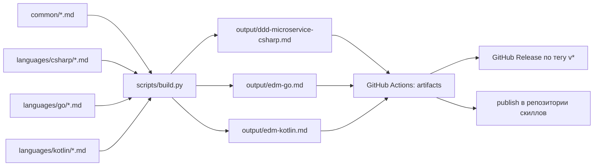

# emd-skills

[](https://github.com/Ekstrem/emd-skills/actions/workflows/build-all.yml)

Навыки (skills) для проектирования событийно-управляемых микросервисов (EDM/CEQRS):
общие этапы лежат в `common/`, языко-специфичные — в `languages/<язык>/`.



## Как собирается

Из одного набора этапов получаются два вида вывода:

| Вывод | Что это | Для кого |
|-------|---------|----------|
| `output/<name>.md` | все этапы склеены в один самодостаточный `SKILL.md` | агенты без поддержки пакетов навыков, чтение глазами |
| `output/skills/<name>/` + `<name>.zip` | **пакет навыка**: `SKILL.md`-роутер + `references/*.md` | Claude Agent Skills, DSH и любой агент с прогрессивным раскрытием |

Порядок склейки берётся из `scripts/stages.yaml` и задан явно, а не алфавитом: этапы
читаются последовательно (канвасы → Command API → Query API → MV → реализация).

Пакет собирается из роутера `languages/<язык>/skill.md` — это и есть `SKILL.md`
пакета: заголовок `name`/`description` и маршрут по этапам. Файлы этапов кладутся
рядом в `references/`, поэтому агент читает их по требованию, а не тащит 60 КБ
в контекст сразу. Раскладка zip — `<name>/SKILL.md` и `<name>/references/*.md`
(требование [Claude Skills API](https://platform.claude.com/docs/en/api/skills):
все файлы в одном каталоге верхнего уровня, `SKILL.md` в его корне).

## Локальная сборка

```bash
python scripts/build.py          # все языки: .md + пакеты + zip
python scripts/build.py go       # только Go
python scripts/build.py --check  # проверка без записи файлов
```

Нужен только Python 3.10+ — PyYAML и другие зависимости не требуются.

## CI

`.github/workflows/build-all.yml`:

| Джоба | Когда | Что делает |
|-------|-------|------------|
| `discover` | push, PR, вручную | читает `languages/*/config.yaml` и строит матрицу языков |
| `build` | там же | собирает каждый язык отдельной джобой, проверяет `.md` и пакет, выкладывает `skill-<name>` и `skill-<name>-bundle` |
| `release` | тег `v*` | прикрепляет собранные `.md` и `.zip` к GitHub Release |
| `rolling-release` | push в `main` | обновляет релиз `latest` актуальной сборкой (ссылка [`/releases/latest`](https://github.com/Ekstrem/emd-skills/releases/latest) всегда на свежие файлы) |
| `publish` | push в `main` | кладёт `SKILL.md` в репозиторий из `publish_repo` (нужен секрет `SKILL_REPO_PAT`) |

## Где скачать скиллы

Собранные скиллы **не лежат в репозитории** — каталог `output/` в `.gitignore`, файлы
создаёт CI. В каждом источнике лежат и `.md`, и `.zip`-пакеты.

| Источник | Где смотреть | Срок жизни |
|----------|--------------|------------|
| **Latest build** | [`/releases/latest`](https://github.com/Ekstrem/emd-skills/releases/latest) — пересобирается на каждый push в `main` | постоянно |
| **Версии** `v*` | раздел **Releases** на главной странице репозитория | постоянно |
| Артефакты прогона | **Actions** → нужный run → блок **Artifacts** внизу страницы | 90 дней |

Зафиксировать версию (джоба `release`):

```bash
git tag v0.2.0 && git push origin v0.2.0
```

Раздел **Packages** здесь не используется: скиллы — это markdown-файлы, а не образы
или npm-пакеты, поэтому пакетов там не появится.

## Установка пакета навыка

Скачанный `<name>.zip` разворачивается в каталог навыков, содержимое — один каталог
`<name>/` с `SKILL.md` внутри:

| Куда | Когда |
|------|-------|
| `<проект>/.dsh/skills/` | навык нужен только в одном репозитории (коммитится вместе с ним) |
| `~/.dsh/skills/` | навык нужен всегда (Windows: `C:\Users\<вы>\.dsh\skills\`) |
| Claude: загрузка навыка | zip принимается как есть — `SKILL.md` в корне каталога |

```bash
# DSH, пользовательский каталог
unzip edm-go.zip -d ~/.dsh/skills/
# ожидаемый результат: ~/.dsh/skills/edm-go/SKILL.md + references/
```

Для Claude-совместимых агентов описание навыка (`description`) — единственное, по чему
выбирается навык, поэтому держите его в пределах 500 знаков и начинайте с «Use when…».

## Добавить язык

1. Создать `languages/<язык>/config.yaml`:

   ```yaml
   name: "edm-rust"                    # имя скилла: строчные буквы, цифры, дефис
   description: "Одна строка про скилл"
   output_file: "edm-rust.md"          # имя файла в output/
   language: "Rust"
   test_framework: "cargo test"
   build_command: "cargo build"
   test_command: "cargo test"
   package_manager: "cargo"
   # publish_repo: "edm-rust-skill"    # опционально: куда публиковать SKILL.md
   ```

2. Положить этапы `*.md` в `languages/<язык>/`.
3. Добавить ключ `<язык>` со списком этапов в `scripts/stages.yaml`.
4. Создать роутер `languages/<язык>/skill.md` — он станет `SKILL.md` пакета:

   ```markdown
   ---
   name: "edm-rust"                              # должен совпадать с config.yaml
   description: "Use when designing an event-driven Rust microservice..."  # ≤ 500 знаков
   ---

   # EDM на Rust

   | # | Шаг | Читай |
   |---|-----|-------|
   | 1 | Bounded Context Canvas | `references/bounded-context-canvas.md` |
   ```

5. Собрать: `python scripts/build.py <язык>`.

Сборка падает, если `.md`-файл лежит в `common/` или `languages/<язык>/`, но не указан
в `scripts/stages.yaml`: так контент не теряется молча. Так же она проверяет роутер:
`name` должен совпадать с `config.yaml`, `description` — не длиннее 500 знаков,
а `references/*.md` должны покрывать ровно те этапы, что перечислены в `stages.yaml`
(лишние ссылки и забытые этапы — ошибка, а не тихий пропуск). Те же проверки выполняет
джоба `discover`, поэтому битый конфиг виден до запуска сборки.

## Плейсхолдеры

В тексте этапов можно писать `{{ключ}}` — подставится значение из `config.yaml`
(`{{language}}`, `{{test_framework}}`, `{{build_command}}`, `{{test_command}}`,
`{{package_manager}}`). Неизвестный плейсхолдер — ошибка сборки.
