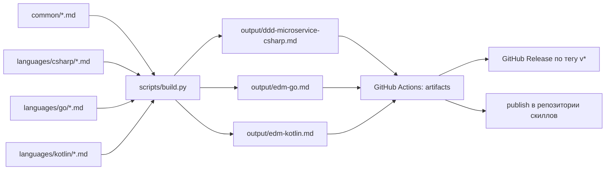

# emd-skills

Навыки (skills) для проектирования событийно-управляемых микросервисов (EDM/CEQRS):
общие этапы лежат в `common/`, языко-специфичные — в `languages/<язык>/`.



## Как собирается

Каждый язык — это один самодостаточный `SKILL.md`: YAML-заголовок (`name`,
`description`) + все общие этапы + этапы своего языка в порядке из
`scripts/stages.yaml`. Порядок склейки задаётся явно, а не алфавитом: этапы читаются
последовательно (канвасы → Command API → Query API → MV → реализация).

## Локальная сборка

```bash
python scripts/build.py          # все языки
python scripts/build.py go       # только Go
python scripts/build.py --check  # проверка без записи файлов
```

Нужен только Python 3.10+ — PyYAML и другие зависимости не требуются.

## CI

`.github/workflows/build-all.yml`:

| Джоба | Когда | Что делает |
|-------|-------|------------|
| `discover` | push, PR, вручную | читает `languages/*/config.yaml` и строит матрицу языков |
| `build` | там же | собирает каждый язык отдельной джобой, проверяет артефакт и выкладывает `skill-<name>` |
| `release` | тег `v*` | прикрепляет собранные `.md` к GitHub Release |
| `publish` | push в `main` | кладёт `SKILL.md` в репозиторий из `publish_repo` (нужен секрет `SKILL_REPO_PAT`) |

Скачать артефакты: вкладка **Actions** → выбранный run → раздел **Artifacts**.

## Добавить язык

1. Создать `languages/<язык>/config.yaml`:

   ```yaml
   name: "edm-rust"                    # имя скилла: строчные буквы, цифры, дефис
   description: "Одна строка про скилл"
   output_file: "edm-rust.md"          # имя файла в output/
   language: "Rust"
   test_framework: "cargo test"
   build_command: "cargo build"
   test_command: "cargo test"
   package_manager: "cargo"
   # publish_repo: "edm-rust-skill"    # опционально: куда публиковать SKILL.md
   ```

2. Положить этапы `*.md` в `languages/<язык>/`.
3. Добавить ключ `<язык>` со списком этапов в `scripts/stages.yaml`.
4. Собрать: `python scripts/build.py <язык>`.

Сборка падает, если `.md`-файл лежит в `common/` или `languages/<язык>/`, но не указан
в `scripts/stages.yaml`: так контент не теряется молча. Те же проверки выполняет
джоба `discover`, поэтому битый конфиг виден до запуска сборки.

## Плейсхолдеры

В тексте этапов можно писать `{{ключ}}` — подставится значение из `config.yaml`
(`{{language}}`, `{{test_framework}}`, `{{build_command}}`, `{{test_command}}`,
`{{package_manager}}`). Неизвестный плейсхолдер — ошибка сборки.
